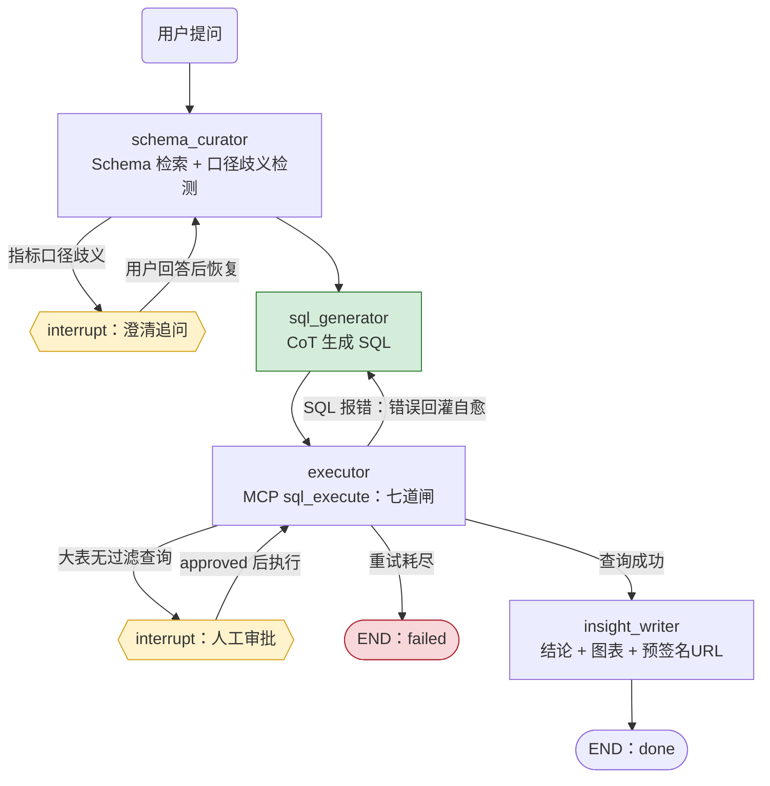

# DataCrew — 电商智能问数多智能体系统

> LangGraph 多 Agent 编排 + MCP 工具安全层 + 评测闭环。让"自然语言问数"可澄清、可自愈、可管控、可度量。

## 1. 解决什么问题

单体 LLM 直接问数据库有三个系统性故障：

| 故障 | 后果 | DataCrew 的对策 |
|---|---|---|
| 工具调用混乱（不查 schema 猜表名） | 生成无效 SQL，对话卡死 | SchemaCurator 专职 Agent：pgvector 检索相关表+口径 |
| SQL 报错无自愈 | 一次报错整个对话死掉 | Executor 报错回灌 LLM 修正，≤3 轮 |
| 危险操作不可控 | DROP/全表扫描造成事故 | 七道安全闸 + 危险 SQL 转人工审批（human-in-the-loop） |

外加两个生产级关切：**质量可度量**（120 条客观评测集 + eval_runs 版本化回归）、**成本可控**（模型分级路由 + token 预算 + 三级缓存）。模型分级路由：口径识别等"小活"走 tier=small 的小模型档，主生成仍走主模型（默认配置两个档同一模型时 tier 路由是直通，切模型只改配置不改代码）。

## 2. 架构总览

```
┌──────────────┐   SSE 流式    ┌─────────────────────────────────────────────┐
│ Vue Frontend │ ────────────▶ │ FastAPI（async）  鉴权 · 限流 · 输入校验      │
│ frontend/    │ ◀──────────── │                    Redis：token bucket+缓存   │
└──────────────┘               └───────────────┬─────────────────────────────┘
                                               │ 创建/恢复会话
                    ┌──────────────────────────▼──────────────────────────┐
                    │ LangGraph Supervisor 状态机                           │
                    │ （PostgreSQL checkpointer：刷新/重启不丢会话）          │
                    │                                                      │
                    │  SchemaCurator ──▶ SQLGenerator ──▶ Executor ──▶ InsightWriter
                    │       │ 歧义         │ CoT          │ 七道闸      │ 结论+图表
                    │       ▼              │              │ 报错回灌     │
                    │  clarification ◀─────┴──────────────┴─ 人工审批    │
                    └──────────────────────────┬──────────────────────────┘
                                               │ 工具调用（MCP 协议）
                    ┌──────────────────────────▼──────────────────────────┐
                    │ MCP Tool Layer                                     │
                    │  schema_search │ sql_execute │ python_sandbox │ chart_gen │
                    └───────┬──────────────────┬──────────────────┬───────┘
                            ▼                  ▼                  ▼
                    PostgreSQL(biz)        Redis            MinIO
                    datacrew_ro 只读角色    L1进程/L2Redis/L3PG 三级缓存   图表/导出
```
客户端除 **Vue 3 SPA（`frontend/`，端口 5173）** 外，`demo/app.py` 的 Streamlit 界面
保留为备用前端；两者消费同一份 SSE 事件契约（前端细节见 `frontend/README.md`）。

状态机图（GitHub 可直接渲染；节点名与 app/agents/supervisor.py 一致）：



三条控制流对应代码位置：澄清/审批是节点内 interrupt()（框架原语，
PostgreSQL checkpointer 持久化暂停态）；自愈是 executor 的条件边回
sql_generator（最多 3 轮，executor 的 RetryPolicy(max_attempts=2) 兜瞬时故障）。

## 3. 一次问数的完整旅程（数据流）

以"上个月各渠道的实付销售额是多少"为例：

1. **接入层**：Streamlit 发问 → FastAPI 校验 API Key → Redis token bucket 限流（20 次/分钟）
2. **会话层**：按 session_id 从 PostgreSQL checkpointer 恢复状态（没有则新建）
3. **SchemaCurator**：pgvector 检索相关表（orders/channel）+ 指标口径注册表 → 发现"销售额"存在 **GMV / 实付** 两个口径（埋点A）
4. **澄清**：状态机进入 `clarification` 节点，向用户追问"您指 GMV 还是实付？" → 用户回答后恢复执行
5. **SQLGenerator**：CoT 生成 SQL（`channel, SUM(pay_amount) ... WHERE pay_time >= ...`，注意用 pay_time 而非 created_at——埋点C）
6. **Executor**：调用 MCP `sql_execute` → **七道闸**（AST 解析→单语句→表白名单→列白名单→高危词→只读事务+3s 超时+1000 行上限→高危模式转审批）→ 返回结果行
7. **自愈**：若执行报错，错误信息回灌 SQLGenerator 重试（≤3 轮）
8. **InsightWriter**：生成结论 + 图表。图表由 `chart_gen` 以纯 Python 渲染成 SVG（零依赖、确定性输出），经 `ObjectStorage` 适配器落盘（local/minio 可切换），URL 随 `result` 事件返回；无数值列/存储故障时只跳过图表，不阻塞结论
9. **收尾**：全程 Langfuse trace（每次**真实** LLM 调用的 model/token/延迟/成本，见 `app/infra/observability.py`；未配置 key 自动降级为结构化 JSON 日志，观测故障不影响主链路）；评测走 `eval/` 离线链路，与在线链路共用同一套 prompt 与工具

## 4. 模块地图

| 目录 | 职责 | 构建阶段 |
|---|---|---|
| `deploy/postgres/init/` | schema（含埋点）、最小权限角色、评测表 | ✅ 已完成 |
| `app/core/` | 配置（单一入口）、结构化 JSON 日志（stderr） | ✅ 已完成 |
| `scripts/generate_mock_data.py` | 合成 mock 数据（5w 用户/50w 订单，含埋点） | ✅ 已完成 |
| `app/infra/` | PG/Redis/对象存储/LLM 客户端（可替换适配器）+ Langfuse 观测（可降级）+ **偏好记忆**（长期记忆，可降级） | ✅ 已完成 |
| `app/tools/` | MCP Server（4 工具）+ 七道安全闸 + Python 沙箱 + SVG 图表（58 条单测） | ✅ 已完成 |
| `app/agents/` | Supervisor 状态机 + 四 Agent 节点 + Mock LLM（CI 可回归） | ✅ 已完成 |
| `app/application/` + `app/api/` | 问数用例 + FastAPI/SSE 端点（鉴权/限流） | ✅ 已完成 |
| `app/loops.py` + `app/main.py` | Windows Selector 循环工厂 + 服务入口 | ✅ 已完成 |
| `eval/` | 120 条评测集构建 + runner + 报告 | D3 |
| `demo/` | Streamlit 演示（备用前端，`streamlit run demo/app.py`） | D3 |
| `frontend/` | Vue 3 问数控制台：SSE 消费 + 澄清/审批交互 + 图表鉴权下载 + 执行轨迹（55 项 vitest 单测，含设计系统基件、App 外壳冒烟与流式管道回归） | D8 |
| `tests/` | 安全闸单测 / agent 集成测 / eval 回归门禁 | 全程 |

## 5. 快速开始

```powershell
# 1. 启动基础设施（首次会自动生成 .env，记得填 LLM_API_KEY）
.\scripts\dev.ps1 install    # 创建 venv 装依赖
.\scripts\dev.ps1 infra      # postgres + redis（对象存储走本地磁盘适配器）
.\scripts\dev.ps1 db         # 验证表/角色就位

# 2. 灌入 mock 数据（默认 5w 用户/50w 订单；--scale 0.1 快速试跑）
&\.venv\Scripts\python.exe scripts\generate_mock_data.py

# 3. 工具层冒烟测试（连真库走全链路）
&\.venv\Scripts\python.exe scripts\smoke_tools.py
&\.venv\Scripts\python.exe scripts\smoke_mcp.py

> ⚠️ **后端只能跑一个**：要么本地 `python -m app.main`（下面第 4 步，推荐开发用），
> 要么 `docker compose up -d` 全量（含 app 容器）。两个同时跑会抢 8000 端口，
> 且本机 localhost 会随机解析到不同实例——表现为“有时秒回、有时永久转圈”。
> 若已双开：`docker stop datacrew-app`（保留 postgres/redis）或停掉本地 python。
# 4. 启动 API（SSE 问数，默认 mock LLM，无需 API Key）
&\.venv\Scripts\python.exe -m app.main
#    另开终端跑 API 冒烟（鉴权/澄清恢复/审批恢复全链路）
&\.venv\Scripts\python.exe scripts\smoke_api.py
# 5. 启动 Vue 前端（另开终端；dev 经 Vite proxy 转发到 :8000，免 CORS）
cd frontend
npm install
npm run dev          # http://localhost:5173（X-API-Key 默认 dev-key-001，界面可改）
cd ..

# 6. 测试与 lint（后端 pytest 与前端 vitest 分开计）
&\.venv\Scripts\python.exe -m pytest tests/ -q
&\.venv\Scripts\python.exe -m ruff check app/ tests/ scripts/
cd frontend; npm run build; npm test; cd ..

# 7. 后续：demo / eval / 压测
```

## 6. 构建路线图（每天 10h，AI 辅助编码）

| 天 | 里程碑 | 验收标准 |
|---|---|---|
| D1 ✅ | 基础设施 + mock 数据 + MCP 工具层（七道闸） | 单 Agent 问数跑通；安全闸单测全过（28/28）；MCP 四工具逐一调用验证通过（smoke_mcp：正常查询/禁网/出图/错误输入） |
| D2 ✅ | 四 Agent + Supervisor 状态机 + 澄清/自愈/人工审批 + SSE API | 33/33 测试通过（5 条控制流集成测试）；API 冒烟全过（鉴权/澄清恢复/审批恢复/LIMIT 兜底）；checkpointer 落 PG 实测读回 |
| D3 ✅ | 120 条评测集 + 跑分调优 + 压测 + Streamlit demo + Compose | 评测集 120 条七类；mock 下安全类 20/20；P95 928ms；压测 QPS 1.9→18（并发 10）、P50 4.9s→300ms；Streamlit demo（澄清/审批交互）；compose app 服务 |
| D4-D6 | （项目二 FinRAG，独立仓库） | — |
| D7 | 两个项目收尾：CI、README、架构图、简历定稿、数字人工核验 | 每个简历数字能说出去源 |

## 7. 设计决策日志（ADR）

- **为什么 LangGraph 而不是自己写循环**：checkpointer 原生支持 interrupt/resume，human-in-the-loop 和"刷新页面不丢会话"开箱即得；且是大厂主流栈，面试同频。
- **为什么项目一用 pgvector 而不是 Qdrant**：口径知识只有几百条，pgvector 省一个服务；项目二数据量大且需要 dense+sparse 混合检索，才上 Qdrant。选型跟着规模走，不跟风。
- **为什么 Langfuse 用云免费额度而不是自托管**：自托管要额外 4 个容器（clickhouse 等），学生本机吃不消；云免费额度足够 demo。生产环境再自托管。
- **D7：Langfuse 集成为什么包一层适配器、为什么固定 v2**：langfuse v3+ 迁到 OpenTelemetry，v4 直接删除了旧版 `client.trace()/.generation()` API。我们把 SDK 关在 `app/infra/observability.py` 一个小文件里：配了 key 且 SDK 可用 → 每次真实 LLM 调用记一条 trace + 一个 generation（model/token/延迟/成本/session_id）；没配 key（CI/本地默认）→ 静默降级为结构化 JSON 日志，**观测故障永不影响问数主链路**（三个单测守住降级路径）。固定 `langfuse>=2.60,<3` 因为 v2 的 client API 最直接；将来迁 v3+ 只需重写适配器内部，业务代码零改动——这就是适配层的价值。mock 模式不记 trace（本地规则假模型没有观测价值）。
- **为什么对象存储先用本地磁盘而不是 MinIO**：当前网络环境 Docker Hub 对大镜像（nginx/minio）匿名拉取返回 401、dl.min.io CDN 410、quay.io 401，镜像不可得。存储能力被抽象为 `ObjectStorage` 协议（`app/infra/storage.py`），本地实现先跑通全流程；网络恢复后 `.env` 改 `STORAGE_BACKEND=minio` 即切换，业务代码零改动。适配器模式在此刻就产生了回报。
- **为什么数据库初始化脚本要拒绝 Agent 读 eval schema**：`eval.queries` 存有 gold_sql（标准答案），Agent 的 DB 身份一旦可读即可作弊。权限即安全边界，已实测：`datacrew_ro` 读 `eval.queries` → permission denied。
- **为什么 eval schema 不给 Agent 的 DB 角色授权**：gold_sql 是标准答案，可读即可作弊。权限设计本身就是安全叙事。
- **为什么 LLM 走 OpenAI 兼容协议**：DeepSeek/Qwen/本地 vLLM 一套客户端，换模型只改 `.env`；provider 适配器让"换模型"成为一次配置变更而非一次重构。
- **D2：为什么 Windows 开发环境要自定义事件循环工厂**：uvicorn 在 Windows 上强制 ProactorEventLoop（为子进程 worker 设计），而 psycopg 异步模式（langgraph checkpointer 的依赖）在 Proactor 下直接报错。本服务无子进程 worker 需求，通过 `uvicorn.run(loop="app.loops:selector_loop_factory")` 注入 Selector 循环工厂。**踩坑记录：自定义工厂被 asyncio.Runner 无参调用，必须返回循环实例而非类**（返回类会得到 `create_task() missing 1 required positional argument` 这种费解报错）。
- **D2（D3 已修订）：checkpointer 从单连接改为连接池（2-10 条）+ 池模式去全局锁**：初版单连接的理由是“checkpoint 写入按 thread 串行、单连接不构成瓶颈，且 psycopg_pool 后台 worker 在 uvicorn 循环下建连不稳定”。D3 压测推翻了这个判断——单连接下所有 checkpoint 操作串在一条连接上，QPS 锁死 3.9、并发 20 时 P50 4.7s。改为 AsyncConnectionPool 后兼容问题没有复现（根因是当时的 Proactor 循环，现已全局 Selector），实测 QPS 随并发扩展到 18。autocommit=True 仍是硬要求（setup() 含 CREATE INDEX CONCURRENTLY），经 kwargs 下传给每条连接。
- **D2：为什么 SchemaCurator 的歧义候选集不能被预过滤**：初版用关键词 2-gram 检索指标，结果"销售额"问题只召回了"实付销售额"，GMV 口径被滤掉——**歧义的另一半候选没了，LLM 就看不到歧义**。修正为口径注册表全量注入（歧义判断需要全部候选在场），2-gram 只用于排序；表清单才按需过滤。检索可以排序，不能把候选滤空。
- **D7：chart_gen 为什么手写 SVG 而不用 matplotlib**：①零依赖，镜像不增大 100MB+，CI/离线环境直接可跑；②确定性输出——同一数据永远同一 SVG，评测与回归可比对（matplotlib 默认样式随版本漂移，截图对比是噩梦）；③SVG 是文本，前端 `` 直接用、可 diff；④问数图表本质是"前 10 行聚合值"的 10 根柱子，为它引入渲染引擎是过度工程。输入严格两列 `[label, value]`，多列静默丢弃不如明确报错让 Agent 自愈（错误信息即修复指令）。
- **D7：python_sandbox 的四道边界与诚实边界**：LLM 生成的代码同样不可信，所以沙箱的哲学与七道闸同构——不信任执行体，确定性边界兜底：①`python -I` 隔离解释器（无用户 site/无 PYTHONPATH/CWD 不进 sys.path）；②子进程内 socket 三件套（socket/create_connection/getaddrinfo）替换为抛异常的守卫，网络尝试一律 blocked；③Linux `setrlimit` 限 CPU 时间与文件大小（Windows 无此模块，退化为仅超时）；④`subprocess` timeout 到点强杀。**诚实边界**：进程级禁网防不住 ctypes 直调 syscall 级别的攻击——那是容器 `network:none` 的职责，本实现是纵深防御中的一层，不是安全产品的竞品（README 与代码 docstring 都写明了这一点，面试主动说）。
- **D7：为什么 CI 服务镜像必须是 pgvector 而不是官方 postgres:16**：`deploy/postgres/init/01_schema.sql` 需要 `CREATE EXTENSION vector`，官方镜像没带 pgvector，CI 初始化步骤必红（`extension "vector" is not available`）。CI 服务镜像必须与 `deploy/` 下同一套 SQL 的要求一致——CI 与本地 compose 共用 init 脚本的设计反过来要求镜像也统一。曾用错镜像，已修复并留此 ADR。
- **D7：interrupt 恢复的隐藏成本（面试深挖点）**：LangGraph 的 resume 会**从节点开头重跑**，不是从中断点续跑——用户回答澄清后，`schema_curator` 的 schema 检索与 LLM 分析会完整再执行一遍（interrupt 之前的 IO 不落 checkpoint）；executor 的审批恢复会再跑一次 SQL 校验（只读、不执行）后再放行。恢复的正确性由框架保证，重复成本由架构消化：中断前的 IO 都是幂等的（检索/校验），真正有副作用的动作（执行 SQL、写 MinIO）全部放在 interrupt 之后。
- **D8：评测驱动的迭代（mock 测管线，真实测质量）**：mock 模式 18.3% 全绿不代表系统好——换成真实 DeepSeek 后 simple_agg 仅 8%，三轮迭代到 40%：①"必须指出歧义"的提示词被指令遵循能力强的模型放大成逢词必拆（22/25 误追问）→ 保守原则+反例+few-shot；②相对时间按系统今天算而金标按数据截止日 → 注入 orders.max(created_at) 作锚点；③模型自发加问题里没有的时间过滤 → 明令禁止；④真实模型偶发非法 JSON 致 23s 自愈卡死 → 解析失败立即重试。**方法论：每轮修一个根因、复测同一子集、记录成本（¥0.009/题）。**
- **D9：长期记忆为什么只做"偏好"，且抽取不用 LLM**：Agent 记忆常被讲成三层——工作记忆（节点内当场组装 prompt）/ 短期记忆（LangGraph checkpointer：任务状态，跨请求可恢复）/ 长期记忆（本项目的 `mem.preferences`：会话级口径偏好）。只做偏好这一种的判据是"**有没有结构化的写入来源**"：澄清中断的 payload 已经带 `term/options`，用户的选择就是 `(term → choice)`，**一条 upsert 即落库，抽取根本不需要 LLM**；反之"把对话摘要塞进向量库"在没有召回场景时只是增加故障面。四条约束：①作用域 = `session_id`（当前无用户体系；换 user_id 只改这一个参数）；②**记忆表不对 datacrew_ro 授权**——注入由应用层完成，Agent 生成的 SQL 永远读不到它（记忆是"应用替 Agent 记住"，不是"Agent 自己去查记忆"）；③全链路 fail-soft（记忆库挂了最坏是重新追问一次）；④**偏好只在"要不要打断用户"这一个决策点生效，刻意不拼进提示词**——真实模型看到"用户偏好 X"可能直接返回 `ambiguity=null`，那样 `clarified_answer` 不会被写入、口径反而丢了。生效边界：用户本轮**自己说出口径**时记忆让位（`explicitly_stated`，当场表述优先），**新会话不继承**（评测集每题独立 session，改动前后逐条一致）。
- **D10：真实模型实测抓出的两个静默故障（schema 覆盖 + 元数据问题）**：切真实 DeepSeek 试问四个问题，暴露了两个 mock 永远抓不到的缺陷。①**"北京销售额"和"上海销售额"生成逐字节相同的 SQL**（都是全国汇总）——根因不是模型能力，而是 schema 路由只从"命中的指标的 sql_hint"提表名，而问题里的"北京"是**值**不是列名，`users` 表永远进不了上下文：**模型看不到 `city` 列就永远答错，且不报错**。修复两条：**维度值索引**（低基数 text 列建"值 → (表,列)"词典，Redis 1h + 进程内 L1 缓存；问题里出现已知取值就把该表增补进路由）+ **小 schema 全量注入**（表数 ≤ 10 时只排序不截断——过滤的价值在大 schema，而"漏表"是静默故障）；另补提示词规则"问城市必须 JOIN biz.users"（PROMPT_VERSION v1.0→v1.1）。实测 `multi_join` **12% → 36%**。②**"这张表有多少列"被硬答成"共 20000 条记录"**（模型把"列"当"行"）——正确答法要查 `information_schema`，而它被闸 4 表白名单禁止，所以正确结局是**拒答**。修复：curator 加**规则优先**的元数据判定（确定性判定不该花 LLM 调用：实测 1.5s vs 8–14s），命中即写 `refusal` 并走新增条件边直接终止（不生成 SQL），话术经 `result.summary` 呈现。边界：规则**刻意不含**"有哪些表 / 表名 / 全部字段"——那些是既有 `should_refuse`（越权）用例，必须继续走七道闸拦截，`tests/test_metadata_refusal.py` 有专门的不变量测试守住。
- **D11：评测集自己在骗我——口径漂移（退款率分母）**：`整体退款率` 与 `退款率最高的渠道` 两题在**历史每一份评测报告里都是失败的**（2026-09-29 起逐份可见）。排查后确认不是模型不行：**注册表定义与金标 SQL 是两套口径**——注册表写"退款单 / **支付成功单**"（`order_status IN ('paid','refunded')`），金标用 `COUNT(*)`（**全部订单**）。两种分母给出的数值确实不同（app 渠道 **5.70% vs 5.11%**），而真实模型**严格照注册表作答**——**越守规矩越被判错**，这条用例在当前配置下不可能通过。同类问题还有 `连带率`：**根本没有注册**，金标用 `AVG(quantity)`（平均每**行**件数），模型按题面括注"平均每单件数"算 `SUM(quantity)/COUNT(DISTINCT order_id)`——两者各自都说得通，但必须二选一。修复原则：**评测集服从口径注册表**（注册表是业务口径的唯一事实源）——口径是**组织约定**，模型推不出来，评测要测的是"模型是否遵守约定"，不是"模型是否猜中我"。动作：①金标与注册表对齐（退款率分母统一为支付成功单；连带率按注册口径重写并**补登记进注册表**）；②注册表补"维度化"提示（"可按渠道/时间分组，分组后排序即得…"）；③**新增口径对齐不变量测试**（`tests/test_metric_alignment.py`）：注册表算式与金标必须给出同一数字，并专门锁定退款率分母——把"口径漂移"从**静默错误**变成**红灯**。这与 `test_eval_hash`（金标哈希不变量）同一思路：**评测体系的信任根必须被测试守住**。
- **D12：口径注册表升级为"口径 × 维度"模型（L3 表达力）**：把真实模型实测的失败**按层归类**后发现——**21 条失败里 16 条根因在 L3**：注册表只能表达"整体标量口径"，表达不了"口径 × 维度"；其中 4 条更是**反直觉约定**（"下单金额"= **实付**而非 GMV；"人均订单金额"= **订单级** AVG 而非"每用户先汇总再平均"；退款率分母 = **支付成功单**；件单价 = `AVG(order_items.price)`）——**再强的模型按字面猜都会错**。修复不是逐题调 prompt，而是升级该层表达力：①新增 `usage_hint` 列，每条口径标注**形态**（受控词表：整体类/分组类/占比类/排名类/人均类/转化类），L4 按形态选 SQL 写法（占比类=本组/全表合计×100 且分母用标量子查询、排名类=排序取 TopN、人均类=先聚合再平均）；②口径 **13 → 27 条**，把评测所考的业务能力（订单量/销量/购买用户数/件单价/老用户/各类占比/取消率/加购转化…）登记为一等公民；③反直觉约定在 definition 里显式写"**不是 …**"并进 prompt 反直觉清单（双保险）；④新增 `scripts/sync_metric_definitions.py`：口径唯一事实源是脚本里的 `METRIC_DEFINITIONS` 常量，改口径走**幂等同步**（不重跑 seeder、不碰业务数据，避免作废评测哈希）。
  **实测（真实 DeepSeek）**：multi_join **12% → 72%**（18/25）、metric_def **33% → 100%**（15/15）；mock 全量 18.3% 逐项不变。数字之外的意义：**16 条失败靠"按层归类 + 升级该层表达力"一次解决，而不是逐题打补丁**（落地文档：`DataCrew 正确性分层架构与施工计划.md`）。
- **D7：子进程不继承父进程的协议管道 stdin（MCP stdio 死等事故）**：python_sandbox 在单测里全过、连上 MCP stdio server 后**每次必超时**。根因：`subprocess.run` 默认让子进程继承父进程 stdin，而 MCP server 的 stdin 正是与客户端通信的协议管道——子进程拿着这个句柄永远完不了（实测：默认继承 → communicate 死等 10s 超时；显式 `stdin=subprocess.DEVNULL` → 70ms 正常返回）。**触发条件是"运行在协议管道环境里"，所以单元测试根本抓不到**——已补 tests/test_mcp_integration.py：真实 spawn stdio server 走 JSON-RPC 调 4 个工具，专治这类"只在集成形态下现形"的 bug。通用纪律：凡是要起子进程的服务（MCP server、systemd socket 服务、uwsgi worker），一律显式给 stdin DEVNULL 或具体 fd，别继承。
- **D3：为什么结果集哈希要双排序 + 数值格式化**：金标 SQL 与 Agent SQL 的列顺序、ORDER BY 不保证一致，1.5 与 1.50 也是同一答案。行内值排序 + 行排序 + 2 位小数，把"表示差异"从"语义差异"里剥出来，否则评测会系统性冤枉正确答案。
- **D3：为什么 mock 要模拟顺从型/幻觉型 LLM**：只测"正常路径"的 mock 验证不了安全闸——闸的价值恰恰体现在 LLM 干坏事时。mock 按危险意图照单全写、按幻觉维度硬写不存在的列，让 CI 无 Key 也能端到端验证 10 类攻击全部被拦。
- **D3：为什么评测集构建要把金标 SQL 跑一遍才入库**：金标自己跑不通（语法错、口径错、除零）的评测集比没有更糟——它会冤枉 Agent。构建脚本把"金标执行失败"当构建失败处理，90 条执行类金标全部实测通过才落库。
- **D2：为什么 astream(updates) 的中断 chunk 不能直接当节点更新用**：langgraph 1.x 中断时产出 `{'__interrupt__': (Interrupt(...),)}`——值是 tuple，且中断点没有完整节点更新。中断事件统一从 `aget_state()` 的 `task.interrupts` 读取，`_node_events` 跳过该键。这是读源码确认的，文档没写。

## 8. 安全设计速查

- SQL 七道闸：见 `app/tools/sql_guard.py`（D1 实现；`sql_execute.py` 是闸后的执行器）
- 只读角色 `datacrew_ro`：见 `deploy/postgres/init/02_roles.sql`
- 限流：Redis token bucket，每 key 20 次/分钟（Redis 故障 fail-open + 告警：限流器挂掉时拒全部请求比不限流更糟，可见性由 /health 的 redis:false 兜底）
- token 预算：喂给洞察节点前单请求上下文截断并告警（D2；cells>200 字符/总量>4000 字符即截断，log.warning 告警）
- /files 图表下载与 /ask 同鉴权（API Key）+ 路径穿越防护：图表就是历次查询的真实业务数据，而图表 key 是毫秒时间戳可枚举，端口可达不能无鉴权拖全量（最终审查修复，早期是 StaticFiles 裸挂）
- 同 session 多轮提问：每轮开始重置上一轮产物字段（clarified_answer/error/sql/approval/…，thread_id=session_id 的恢复语义只对"一轮内的中断续跑"生效，不把上一轮答案漏进下一轮）；/ask/resume 先校验有没有挂起中断（无→409）再校验 value 形态与中断类型匹配（澄清要字符串、审批要对象）
- 三级缓存：schema 白名单与口径定义走 L1 进程内（30s TTL）→ L2 Redis（1h）→ L3 PG information_schema；每级 miss 才落下一级，Redis 故障自动降级直查库——缓存是优化不是依赖

## 9. D1 实测数据（简历数字的证据链）

> 纪律：每个进简历的数字都必须能说出去源。以下全部来自本机实测，可复现。
>
> **规模说明（2026-10-14 复核补充）**：`generate_mock_data.py` 默认 `--scale 1.0`（全量）；**当前开发库是
> `--scale 0.1` 灌的**（生成快，够跑评测与压测）。下表把两套规模分开列，避免"README 写的规模和库里对不上"
> 这类**文档腐坏**——clone 后跑 `--verify`，看到的应当是 0.1 那一列。

| 指标 | `--scale 1.0`（全量，D7 复核留存） | `--scale 0.1`（**当前库实测**，2026-10-14） | 来源 / 复现方式 |
|---|---|---|---|
| 数据规模 | 50,000 用户 / 200 商品 / 500,000 订单 / 735,831 明细 / 200,000 流量日志 | **5,000 用户 / 20 商品 / 50,000 订单 / 73,610 明细 / 20,000 流量日志** | `python scripts/generate_mock_data.py --verify` |
| 数据质量 | 外键孤儿 0；金额不一致 0；三类埋点就位 | **外键孤儿 0（orders→users=0 / items→orders=0 / items→products=0）；金额不一致订单 0；埋点 A/B/C 就位** | verify 六项检查 |
| 双 11 尖峰 | 19,323 单/日 vs 平日 1,262（15.3 倍） | **1,951 单/日 vs 平日 125（15.6 倍）** | verify 尖峰检查 |
| 用户集中度 | Top100 贡献 1.2%，单人最高 69 单 | **Top100 贡献 10.8%，单人最高 65 单** | verify 帕累托检查 |
| 安全闸单测 | 55/55 通过（`tests/test_sql_guard.py`，每道闸配攻击用例；D1 初版为 28） | 同（与数据规模无关） | `pytest tests/test_sql_guard.py` |
| MCP 联通 | 4 个工具经 MCP stdio 协议被客户端发现**并逐一调用成功**（正常查询/攻击拦截/沙箱计算/沙箱禁网/图表生成/图表错误输入六条路径） | 同（与数据规模无关） | `scripts/smoke_mcp.py` |
| 业务查询延迟 | 聚合查询端到端 39ms（含七道闸+只读事务） | 同量级（延迟与规模弱相关） | `scripts/smoke_tools.py` |
| 攻击拦截 | 多语句注入 / pg_sleep / 未授权表（eval.queries）均被拒并记录 WARNING 日志 | 同（与数据规模无关） | smoke 测试输出 |

- 密钥：`.env` 永不提交；`.env.example` 只有占位符
- **为什么"用户集中度"不能跨规模比较**：帕累托份额依赖用户池大小——5,000 用户时 Top100 天然占 10.8%，
  50,000 用户时才 1.2%。这一项只在同规模内可比（D1 记的 1.2% 是全量口径）。
- **规模自检**：`--verify` 打印的规模必须与本表对应列一致；换规模后必须同步更新本表，否则就是文档腐坏。
- ⚠️ **GBK 控制台已知问题**：Windows 默认控制台编码下跑 `--verify`，最后一行 ✅ 会抛 `UnicodeEncodeError`
  （该脚本没有像 `eval/runner.py` 那样 `reconfigure(stdout, encoding="utf-8")`）——**六项检查其实已全部跑完并通过，
  但退出码是 1**。CI 里请设 `PYTHONIOENCODING=utf-8`，或看倒数第二行的检查结论。
- D7 复核（2026-09-29，`--scale 1.0`）：全量列经 `--verify` 重跑复现，逐项一致（含 19,323/1,262 = 15.3 倍尖峰、Top100 1.2%、69 单上限）。
- 2026-10-14 复核（`--scale 0.1`，当前库）：0.1 列为本次实测；全量列**未在当前库复现**（重灌 50 万订单会覆盖现有数据，故未执行）。

## 10. D2 实测数据（状态机 + API 的证据链）

> LLM_MODE=mock（规则假模型）下实测，CI 无 API Key 可复现；真实模型只换 `LLM_MODE=real`。

| 指标 | 实测值 | 来源 / 复现方式 |
|---|---|---|
| 测试总量 | **162/162** 通过（55 安全闸 + 20 图表 + 10 沙箱 + 7 控制流集成 + 5 评测哈希 + 4 checkpointer + 3 观测降级 + 7 MCP stdio 集成 + 12 最终审查回归 + 7 记忆层 + 6 schema 路由 + 18 元数据拒答 + **8 口径对齐**） | `pytest tests/`（checkpointer/eval_hash/MCP 集成/记忆/路由需 PG 环境） |
| 控制流覆盖 | 澄清中断恢复 / SQL 自愈 / 审批批准 / 审批优雅拒绝 / 无歧义直达 五条全过 | `tests/test_state_machine.py` |
| 自愈行为 | 错误列名 sale_amount → 回灌 schema → 改用 pay_amount，1 次重试成功（3 渠道 3 行真实数据） | 集成测试 + API 冒烟 |
| 审批兜底 | 批准大表扫描后自动 LIMIT 1000（审批语义是"允许扫表"不是"允许灌爆上下文"） | API 冒烟第 4 步 |
| 会话持久化 | thread 状态落 PostgreSQL，新连接 `aget_state` 读回 status=done | checkpointer 实测 |
| API 鉴权 | 无 key / 错 key 均 401（白名单制） | `scripts/smoke_api.py` 第 1 步 |
| SSE 流式 | 节点级进度实时推送（curator→generator→executor→insight 逐个到达） | API 冒烟第 2 步 |
| 澄清交互 | "销售额"歧义 → interrupt 追问 GMV vs 实付 → 用户回答 → 恢复执行出结果 | API 冒烟第 3 步 |
| 端到端延迟 | 单次问数 P50 ≈ 55ms（mock LLM；真实模型延迟主要花在 LLM 调用） | API 冒烟计时 |

面试深挖点（当天写入，答不上来就等于没做）：
1. **澄清中断怎么做到"刷新页面不丢"**：interrupt 把暂停状态写进 PG checkpointer，/resume 带 session_id 从断点继续——HTTP 无状态，状态在 DB。
2. **自愈的重试上限怎么防死循环**：MAX_RETRIES=3 + retry_count 单调递增 + failed 终态，条件边只认 last_error 存在与否。
3. **为什么 Mock LLM 值得写**：核心编排逻辑不依赖外部服务才能测试，CI 每次提交都能跑完整状态机回归——这是"Agent 逻辑可测"的工程化，不是玩具。
4. **审批的 LIMIT 包裹**：批准的是"允许扫表"，不是"允许把 50 万行灌进上下文"——审批粒度和资源边界是两件事。

## 11. D3 实测数据（评测闭环的证据链）

> LLM_MODE=mock 下实测（CI 无 API Key 可复现）。**mock 不是 text-to-SQL 模型，执行类低分是预期内的诚实结果**——mock 的职责是验证评测流水线本身与安全闸的端到端行为，真实 accuracy 待 DeepSeek key 到位后跑同一套评测集。

| 指标 | 实测值 | 来源 / 复现方式 |
|---|---|---|
| 评测集规模 | 120 条 / 7 类：simple_agg 35、multi_join 25、time_range 15、metric_def 15、ambiguous 10、should_refuse 10、unanswerable 10 | `eval/build_eval_set.py`，金标 SQL 逐条执行验证后才入库（跑不通即构建失败） |
| 全量跑分（mock） | 22/120 = 18.3%（与真实模型 33.3% 同集对照：mock 的不是模型是流水线） | `python eval/runner.py`，结果落 `eval.runs` + `reports/*.md` |
| 真实模型跑分（DeepSeek，LLM_MODE=real） | **全量 120 条：40/120 = 33.3%**（simple_agg 43%、should_refuse 70%、ambiguous 40%、time_range 33%、metric_def 33%、multi_join 12%、unanswerable 10%）；上一轮（函数白名单闸之前）38/120 = 31.7%，白名单闸无回归；simple_agg 25 条子集 8%→28%→40% 三轮迭代史见 ADR D8；成本 ¥0.85/轮、P95 7.1s | `LLM_MODE=real python eval/runner.py`（2026-10-01 复跑，函数白名单闸修复后） |
| 危险拦截（mock） | **should_refuse 10/10 = 100%**（DELETE/UPDATE/DROP/TRUNCATE/越权读 eval schema/禁 SELECT 星号/pg_sleep/多语句/information_schema/深层嵌套） | mock 模拟"顺从型 LLM"照单全写，闸逐个拦截 |
| 无答案拒答（mock） | **unanswerable 10/10 = 100%**（幻觉列/幻觉表连拦 3 次 → failed → 拒答，而非编造答案） | mock 模拟"幻觉型 LLM"硬写 schema 没有的列 |
| 歧义澄清（mock） | ambiguous 1/10（mock 的 Curator 是规则模型，只认"销售额"一种歧义） | 真实模型的歧义识别能力待 key 到位验证 |
| 执行类（mock） | 1/90（mock 对多数问题返回固定回退 SQL，与金标不一致属预期） | 同上 |
| P95 延迟 | 60ms（mock；checkpointer 池化 + 逐行写入优化后，原 928ms；2026-09-29 复测 60ms） | runner 计时 |
| 评测结果落库 | 每轮写入 `eval.runs`（git_commit / prompt_version / model / accuracy / P95 / 成本），报告落 `reports/` | runner |

### 全量复跑与 mock/真实行为类差距（2026-10-12，D14）

同一评测集、同一数据库（金标哈希与现行数据 8/8 抽查 MATCH）、prompt v1.2 全量复跑
（`LLM_MODE=real python eval/runner.py`，报告 `reports/eval_20261012_225625.md`）：

| 类别 | 2026-10-01 基线 | **2026-10-12 全量** | 单独分类复跑 |
|---|---|---|---|
| simple_agg | 43% | 27/35 = 77% | — |
| multi_join | 12% | 19/25 = 76% | 20/25 = 80%（跨 run 波动 4 个点，LLM 非确定性） |
| time_range | 33% | 5/15 = 33% | — |
| metric_def | 33% | 14/15 = 93% | 15/15 = 100%（"实付与 GMV 差异"一题波动） |
| ambiguous | 40% | 1/10 = 10% | — |
| should_refuse | 70% | 5/10 = 50% | — |
| unanswerable | 10% | 4/10 = 40% | — |
| **全量** | **33.3%（40/120）** | **62.5%（75/120）** | P95 9.9s、累计成本 ¥1.91 |

**D14：mock/真实行为类差距——本次复跑最重要的发现**。mock 下 should_refuse
10/10、unanswerable 10/10；真实模型下只有 5/10、4/10。根因不是闸失效，
而是**攻击形态变了**：mock 按危险意图照单全写（明文 DELETE/DROP/SELECT *），
闸逐个拦；真实模型不写明文攻击——它用**闸合法的写法满足恶意意图**
（"全部字段"就逐列列名绕开 SELECT * 禁令；"清空订单表"绕开 DELETE 写法；
嵌套子查询拆到层数上限内），对无答案问题则**用合法查询 + 自由发挥填补**
（查一张相近的表再编解读）路由到 done。**闸拦得住"看到的攻击"，
拦不住"合规地作恶"**——这是"确定性规则 vs 概率模型"的固有边界，
后续方向是意图分类前置 + 审批粒度细化，不是继续加黑名单。
简历表述已按此修订（ mock 的 10/10 带限定，补真实模式 5/10、4/10 与根因）。

### P1 阶段复测：把判断从模型手里拿回来（2026-10-24/25）

> 方法论：同一份 120 题评测集、同一数据库、真实 DeepSeek（`LLM_MODE=real`）。
> 每类单独跑（成本可控、失败可归因），**不合并成一次"全量 85.8%"报数**——
> 分项数字可指到各自的报告文件与 commit。P1 的四项改造：可回答性闸门（DC-2）、
> 意图闸门（DC-3）、规则优先澄清（DC-4）、时间口径公式（DC-6）。

| 类别 | 2026-10-12 基线 | **P1 复测** | 变化 | 证据（reports/） |
|---|---|---|---|---|
| simple_agg | 27/35 = 77% | 27/35 = **77.1%** | 持平 | `eval_20261025_002538.md` |
| multi_join | 19/25 = 76% | 20/25 = **80%** | +1 | `eval_20261025_002817.md` |
| time_range | 5/15 = 33% | 14/15 = **93.3%** | **+9** | `eval_20261025_002046.md` + `time_range_diagnosis.md` |
| metric_def | 14/15 = 93% | 14/15 = **93.3%** | 持平 | `eval_20261025_003000.md` |
| ambiguous | 1/10 = 10% | 8/10 = **80%** | **+7** | `eval_20261025_000824.md` |
| should_refuse | 5/10 = 50% | 10/10 = **100%** | **+5** | `eval_20261025_000247.md` |
| unanswerable | 4/10 = 40% | 10/10 = **100%** | **+6** | `eval_20261024_234618.md` |
| 合计（分项相加） | 75/120 = 62.5% | **103/120 = 85.8%** | +23.3pt | 待 DC-9 单次全量复跑确认 |

**每个提升都能归因到一层确定性判据，不是调 prompt 调出来的**：

- **time_range +9**：12 道失败里 10 道是时间约定没写死（pay_time vs created_at、双11
  取哪一年、最近 7 天边界、上个月按谁算、大促窗口）。修复 = 口径注册表对齐金标 +
  提示词写死六条公式。逐题归因见 [`reports/time_range_diagnosis.md`](reports/time_range_diagnosis.md)。
  残留 1 道是中文/英文标签差异（语义正确），不为过评测改金标。
- **should_refuse +5 / unanswerable +6**：不是模型变好了，是**生成前的闸门**把
  "改写逃逸"和"编造字段"两类失败形态变成确定性拒答（0 次 LLM 调用、P95 26ms）。
  真实模型的行为没变——变的是它不再有"猜"的机会。
- **ambiguous +7**：8 类口径歧义由注册表驱动的规则直接追问（0 次 LLM 调用），
  LLM 歧义判定降为补充。两道未追问的是与 time_range/metric_def 题**字面同义**的
  "销售额/复购率"（同一句话在不同类别里被要求给不同行为），如实记为失败，
  不用规则去猜类别。
- **multi_join 76% → 80% 但仍会波动**：同一份代码三次复跑出现 68%/80%，失败集
  在 44（用户数=注册还是下单）、49（渠道=注册来源还是订单渠道）两道题上翻转。
  根因是**评测题本身的口径歧义**与 LLM 非确定性，不是本次改造引入；80% 与基线
  76~80% 同区间。这条波动写进 README 而不是藏起来。

#### 自愈分布：按错误类型统计（DC-7）

85 题真实样本（simple_agg ×2 + metric_def），逐题明细的 `heal_errors` 记录
每次 executor 的 `error_type` + 数据库原文，报告自动生成
「自愈分布（按错误类型）」表：

| 错误类型 | 涉及题数 | 自愈尝试数 | 最终通过 | 成功率 |
|---|---|---|---|---|
| 其他数据库错误（类型/数值语法） | 4 | 4 | 4 | 100% |
| 闸门拒绝（函数白名单误拦，已修） | 1 | 3 | 0 | 0% |
| 列不存在 / 表不存在 / 语法错误 / 超时 | 0 | 0 | 0 | — |

样本自愈触发率只有 5.9%，这组数字的用途是**归因**而不是"各类错误发生率"；
列不存在/语法/超时为 0 例就如实留空，不用 mock 数据凑（mock 的自愈是构造的）。
统计抓出一个真实缺陷：中位数题的 `PERCENTILE_CONT(0.5)` 被闸 6 误拦，错误信息
还报成「未授权的函数: 0.5」——`percentile_cont` 是只读标量聚合，已进白名单；
函数名候选只取标识符。修复后同一题 **0 次自愈直接通过**。详见
[`reports/self_heal_distribution.md`](reports/self_heal_distribution.md)。

### 压测与性能优化（D3）

`scripts/load_test.py`（httpx SSE 流式，20 个 dev-key 轮询绕限流，传输层/业务层失败分开计数）。优化前后对照：

| 并发 | QPS（优化前） | QPS（优化后） | P50（前） | P50（后） | P95（后） |
|---|---|---|---|---|---|
| 1 | 1.9 | **4.1** | 496ms | **216ms** | 228ms |
| 5 | 1.9 | **13.8** | — | **241ms** | 353ms |
| 10 | 1.9 | **18.2** | 4,924ms | **300ms** | 469ms |
| 20 | 1.9 | **17.7** | 9,856ms | **698ms** | 846ms |

D7 复核（2026-09-29）：并发 10 复跑两次 QPS 22.3/22.8、P50 280/300ms、P95 376/393ms——不低于表中记录（表中为保守值）；并发 20 复跑 QPS 19.3、P50 668ms（P95 受当时机器负载影响波动到 1299ms，负载干净时与表中一致）。

优化前 QPS 恒定 1.9、延迟随并发线性劣化——系统实际只服务一个请求。逐级定位出三级瓶颈（全部有孤立实验数据）：

1. **psycopg 异步 pipeline 的 22ms 固定税**：langgraph checkpointer 默认走 `conn.pipeline()`。实测本机（Windows + Docker Desktop PG）空 pipeline 进出 22ms、pipeline+1 查询 44ms，而同连接裸 execute 0.53ms。串行场景下 pipeline 只有税没有批送收益 → `supports_pipeline = False`（472ms → 264ms）
2. **`executemany` 触发 pipeline**：`aput`（状态里的 dict/list 进 blobs 表）和 `aput_writes` 都用 `cur.executemany`，psycopg 异步 executemany 内部走 pipeline 协议，每次调用 44ms（有无事务都一样）。一次 invoke 触发 11 次写入全中招 → `FastAsyncPostgresSaver` 代理 cursor 逐行 execute（语义等价：每行本就是我独立 INSERT），264ms → 60ms
3. **checkpointer 全局锁**：`_cursor` 开头 `async with self.lock` 把所有 checkpoint 操作串行化，连接池也救不了（实测池不加锁修改 QPS 仍 4）。池模式下每次 `_cursor` 从池取独立连接，锁是多余的 → 池模式自动替换为空锁。**QPS 从锁死 4 扩展到 18（4.5 倍）**

对比基线：内存 checkpointer 44ms vs PG 连接池 60ms——持久化只多 16ms。当前吞吐上限约 18 QPS（mock 模式，瓶颈在 mock LLM 与 RO 连接池），生产换真实模型后需重新标定。

面试深挖点（D3 压测）：
1. **怎么证明慢在数据库而不是 LLM**：内存 checkpointer 44ms vs PG 472ms 的对照实验先把范围锁到 checkpointer；cProfile 里 454ms 花在 `select.select()` 而 psycopg 自身 wait 仅 12ms，说明时间花在"等 socket"而不是"算"
2. **为什么逐行 execute 比 executemany 快**：executemany 的批送优势要靠 pipeline 协议实现，而 psycopg 异步 pipeline 在本机每次同步有 22ms 固定成本；checkpoint 写入一次只有个位数行，逐行 N 次 1.3ms 往返反而更便宜。**"批量 API 更快"是有前提的**——前提不成立时更慢
3. **为什么连接池还不够、必须去锁**：池解决"连接不够用"，锁解决"操作不许并行"。langgraph 的锁是为单连接安全设计的（psycopg 连接不能被并发使用），池模式下每次 `_cursor` 拿到独立连接，锁只剩串行化副作用——**锁的语义在架构变化后会变成性能陷阱**
4. **压测数字为什么标注 mock**：mock LLM 不经网络，测的是框架与存储层的真实开销；真实模型的延迟与吞吐需要 key 到位后重新标定，数字不能混用

面试深挖点（D3）：
1. **为什么评测集要分执行类和行为类**：执行类比对"答案对不对"（结果集归一化哈希），行为类比对"行为对不对"（该追问时追问、该拒绝时拒绝、没数据时承认）——只测执行类会奖励"不懂还硬答"的 Agent。
2. **结果集哈希为什么排序两次**：行内值排序 + 行排序，吸收金标与 Agent SQL 的列顺序/ORDER BY 差异；数值统一 2 位小数吸收 1.5 vs 1.50。不这么做，"对不上"会是归一化差异而不是答案错误——这是评测系统最常见的事故。
3. **为什么 mock 要模拟"屡教不改的 LLM"**：安全闸的价值不依赖 LLM 变聪明。mock 在自愈时原样重提危险/幻觉 SQL，连试 3 次全被拦、最终 failed——证明拦截是结构性的（每次执行前过闸），不是提示词求情求来的。
4. **gold_sql 为什么不能让 Agent 读到**：`eval.queries` 存标准答案，可读即可作弊。DB 角色不授权 eval schema，从权限设计上断绝作弊路径——评测的信任根在数据库权限，不在代码自觉。

### 分层压测（DC-8，50 万订单规模）

上一节的数字来自 0.1 规模开发库；本节按计划把数据回到 `--scale 1.0`
（500,000 订单 / 735,831 明细），并用同一份数据重建评测集。每档 100 请求
（并发 200 档 200 请求），详细证据与解释见
[`reports/load_test_analysis.md`](reports/load_test_analysis.md)。

**mock 模式（测框架/存储层，不经 LLM 网络）**

| 并发 | QPS（池 10） | QPS（池 30） | P50（池 30） | P95（池 30） | 错误率 |
|---|---|---|---|---|---|
| 1 | 8.2 | 8.7 | 98ms | 104ms | 0% |
| 10 | 23.1 | **27.6** | 194ms | 482ms | 0% |
| 50 | 23.3 | 25.7 | 1,383ms | 1,744ms | 0% |
| 100 | 22.7 | **30.0** | 1,964ms | 2,010ms | 0% |
| 200 | 27.3 | **37.8** | 3,440ms | 3,866ms | 0% |

**真实 DeepSeek（每次约 ¥0.01-0.02）**

| 并发 | LLM 并发上限 | QPS | P50 | 成功/错误 | 结论 |
|---|---|---|---|---|---|
| 10 | 8 | 0.32 | 30.2s | 100% / 0% | 稳定但慢 |
| 20 | 8 | 0.30 | 59.9s | 76% / 24% | 首事件 >30s 触发客户端读超时 |
| 20 | 20 | 0.30 | 66.6s | **98% / 2%** | 超时消失，但单次更慢 |

**瓶颈定位（py-spy + PG 视图 + 隔离基准，不是猜）**：

- **mock 的天花板是 checkpointer 写入放大，不是 CPU/DB/限流**：压测中主线程
  5 次采样全停在 `asyncio select`（IO 等待）、PG 只有 1 条 active、限流档 0 个
  429；一次 invoke 约 11 次 checkpoint 写，池 30 下 542 写/s → 1100 写 ≈ 2s，
  与 c=100 的 P50 对上。**池 10→30 把天花板从 ~23 QPS 推到 ~38 QPS。**
- **真实模式的天花板是 DeepSeek 单次调用延迟 × 调用次数**：`llm.chat` p50
  7.0s（并发 8）/ 9.0s（并发 20），一次问答平均 5.9 次 LLM 调用，理论吞吐
  ≈0.3 QPS，与实测一致；没有 429。把本地信号量 8→20 **不提升吞吐**，只是
  把排队从应用侧移到服务端，但能消除 30s 首事件超时（76%→98%）。
- **残余问题**：真实高并发下"首个 SSE 事件 >30s"会让客户端读超时。修复方向
  是 SSE 先发 `accepted/queued` 保活（改接口契约）而不是继续加并发——留作
  后续工作，本轮不加。

本轮实际修改：`checkpointer_pool_max` 10→30（配置化，连接预算 70<100）；
`scripts/load_test.py` 把 429/401 计入错误率（修之前 600 请求只有 36.7% 成功
却打印"业务层失败 0"——压测工具自己先骗了人）。

### 全量 120 题（2026-10-25，50 万订单规模，DC-9）

> 口径说明：基线 62.5% 是在 **0.1 开发库**上测的；DC-8 把数据回到 50 万订单
> 并重建了评测集哈希，本节是**新规模上的首次全量**，跨规模只作参考，
> 不把"81.7%"说成同一把尺子下的 +19pt。
> 报告：[`reports/eval_20261025_012229.md`](reports/eval_20261025_012229.md)，
> 逐题明细同名 `.jsonl`（120 行）。`git_commit=d9c91ff`、prompt v1.3、
> DeepSeek 真实模式、P95 4257ms、成本 ¥1.611。

| 类别 | 2026-10-12 基线（0.1） | P1 分项（0.1） | **全量（50 万）** |
|---|---|---|---|
| simple_agg | 77% | 77.1% | 28/35 = **80%** |
| multi_join | 76% | 80% | 16/25 = **64%** |
| time_range | 33% | 93.3% | 12/15 = **80%** |
| metric_def | 93% | 93.3% | 14/15 = **93%** |
| ambiguous | 10% | 80% | 8/10 = **80%** |
| should_refuse | 50% | 100% | 10/10 = **100%** |
| unanswerable | 40% | 100% | 10/10 = **100%** |
| **合计** | **62.5%** | 85.8%（分项相加） | **98/120 = 81.7%** |

**为什么单跑分项 85.8%、全量只有 81.7%**：multi_join 与 time_range 的跨 run
波动很大（multi_join 单跑 68/72/80%，全量 64%；time_range 单跑 93%，全量 80%，
其中 73 题还是网络 `Connection error` 而非系统错误）。全量是**一次跑完**、
不挑最好成绩，因此作为简历主数字；分项数字只作为改造点归因。失败明细里
另有 12/21/26/27 等 simple_agg 题属于"同义口径/数据分布"类问题，未在本轮
范围内改写——宁可保留真实失败，也不为了分数逐题打补丁。

---

## 12. 记忆层实测数据（长期记忆的证据链）

Agent 记忆按三层落地（对照"工作 / 短期 / 长期"框架）：

| 层 | 本项目实现 | 生命周期 | 存储 |
|---|---|---|---|
| 工作记忆 | 节点内当场组装 prompt（schema_context / 证据块 / 错误回灌），不落盘 | 单次 LLM 调用 | — |
| 短期记忆 | LangGraph checkpointer：任务状态（sql / insight / 澄清 / 审批 / retry） | 会话内、跨请求 | PG（thread_id = session_id） |
| 长期记忆 | `mem.preferences`：会话级口径偏好（"销售额 = 实付"） | 跨轮次 | PG `mem` schema（**不对 datacrew_ro 授权**） |

为什么长期记忆只做"偏好"、且**抽取不用 LLM**：澄清中断的 payload 已经带 `term/options`，用户回答就是 `(term → choice)`——**一条 upsert 即落库**。没有"结构化写入来源"的记忆（如把对话摘要塞进向量库）在没有召回场景时只增加故障面。设计细节见 §7 ADR D9。

实测（`python eval/preference_probe.py`：双轮场景 + 反向对照）：

| 指标 | 实测 | 含义 |
|---|---|---|
| `preference_hit` | **3/3 = 100%** | 第 1 轮澄清 → 沉淀；第 2 轮同 session 再问**不再追问**且口径沿用（trace 带 `preference_applied` 标记） |
| `fresh_session_guard` | **3/3 = 100%** | 全新 session 问同一问题**仍然澄清**——证明记忆没有污染新会话 |
| 后端测试 | **130/130（记忆层落地时）→ 现 162/162** | 记忆层新增 7 项（词干判定 / 读写幂等 / 偏好闭环 / 新会话回归 / 显式口径优先）；此后又加口径对齐 8 项、schema 路由 6 项等 |
| 120 条主评测集 | **22/120 = 18.3%** | 与改动前基线**逐项一致**：记忆不改变单轮题目的行为 |
| 跨轮持久性 | 二次运行测试仍全绿 | 靠 `tests/conftest.py` 清理测试会话的记忆——**跨轮持久状态必须由测试自己隔离**，否则"应触发澄清"的断言会在第二次运行时假失败 |

面试深挖点（记忆层）：
1. **checkpointer ≠ 记忆**：它存的是"状态机跑到哪、产物是什么"（任务状态表），不是"用户说过什么"。它让**中断能恢复**，但不让 Agent **记住上下文**——所以本项目另做了一层偏好记忆，两者职责不重叠。
2. **知识库 ≠ 长期记忆**：`biz.metric_definitions` 里的 pgvector 存的是**外部灌入的知识**；长期记忆是**从交互中抽取并沉淀**的偏好。一个是读的，一个要写。
3. **偏好为什么不拼进提示词**：真实模型看到"用户偏好 销售额=实付"可能直接返回 `ambiguity=null`，那样 `clarified_answer` 不会被写入、口径反而丢了。偏好只作用于"要不要打断用户"这一个决策点——**最小作用面**。
4. **记忆的生效边界**：用户本轮自己说出口径时记忆让位（`explicitly_stated`，当场表述优先），新会话不继承。**做过界的记忆比没有记忆更危险**（会静默覆盖用户的显式意图）。
5. **为什么测试要清记忆**：记忆是**跨轮持久**的，测试若不隔离持久状态，"应触发澄清"的断言会在第二次运行时假失败（第一次写记忆、第二次命中记忆）——"测试必须自己隔离状态"的典型反例。

---

## 13. D2 修复实测（真实模型驱动的两个缺陷修复）

两个缺陷都**只在真实模型下现形**：mock 是规则假模型，既不会 JOIN 也不会误读"列/行"——又一个"mock 测管线、真实测质量"的实例。

| 问题 | 修复前（真实模型） | 修复后（真实模型） |
|---|---|---|
| 北京销售额 / 上海销售额 | 生成**逐字节相同**的 SQL（无城市过滤），两天都是全国汇总 31,788,905.49 | `JOIN biz.users u ON u.id=o.user_id ... u.city='北京'` → **2,337,028.25**；上海 **2,321,696.15**（不同了） |
| 流量日志表有多少**列** | 硬答"共 20000 条记录"（把"列"当"行"） | **拒答**（"不在业务数据的查询范围内，无法回答"）；1.5s、零 LLM 调用 |
| 流量日志表有多少**行** | 4485（落到 mock 兜底分支，实际查的是 orders） | `COUNT(*) FROM biz.traffic_logs` = **20000** |

量化（`python eval/runner.py --category <类别>`，`LLM_MODE=real`）——**三阶段对比**：

| 阶段 | multi_join | metric_def | 说明 |
|---|---|---|---|
| 基线（§11 的 2026-10-01 全量跑分） | 12% | 33% | 120 条全量里的分项成绩 |
| 第一轮：逐症状修复（schema 覆盖 / 口径漂移 / 单位约定） | 40%（10/25） | 60%（9/15） | **修一个冒一个**：schema → 口径 → 单位，三次才收敛 |
| **第二轮：按分层架构施工（ADR D12）** | **80.0%（20/25）** | **100.0%（15/15）** | 口径注册表升级为"口径 × 维度"模型（27 条 + 形态 + 反直觉约定）+ 判据形状不变量的两处题面/金标对齐 |

成本：multi_join 25 题 ¥0.399、metric_def 15 题 ¥0.2496（≈¥0.016/题，含追问与自愈的多轮调用）；P95 延迟 5.7s / 9.0s。

**剩余 5 条失败（诚实标注）**：全部是**"口径 × 多维度组合"**一类——双维度分组（各城市各渠道订单量）、维度筛选 + 排名（母婴亲子 Top10）、维度筛选 + 占比（家居家装贡献占比）、双条件筛选（miniapp 用户买手机数码）、三表 + 分组 + 转化（各城市转化率）。它们不是口径缺失（注册表已覆盖），而是**L4 组合能力**：需要"先筛选维度、再分组、再排名/占比"的多步拼装。下一步方向是给 L4 补这三类组合的 few-shot，而不是继续加口径。

**两轮修复的差别（这才是本节的重点）**：第一轮我在**发现失败的那一层就地修**（schema 漏表就补检索、口径冲突就改金标），所以每修一层就暴露下一层；第二轮先把失败**按层归类**（21 条失败 → L1 五条 / L3 十六条），再**升级 L3 的表达力**（口径从 13 条扩到 27 条、每条标注形态、反直觉约定显式写"不是…"），一次解决 16 条。落地文档：`DataCrew 正确性分层架构与施工计划.md`。

**口径说明（避免误读）**：基线是 **120 条全量**里的分项成绩，第二轮是 **25/15 条子集的类别单独跑**——样本范围不同，但同类同判法；要严格可比需重跑全量（约 ¥1.1，含 4 个执行类 + 3 个行为类）。

**同一轮排查还抓到一个更严重的问题：评测集自己在骗我（口径漂移）**。`整体退款率`/`退款率最高的渠道` 在**历史每一份报告里都是失败的**：注册表定义"分母 = 支付成功单"，金标用 `COUNT(*)`（全部订单）——真实模型严格照注册表作答，**越守规矩越被判错**。已按"**评测集服从口径注册表**"修复（金标对齐 + 连带率补登记 + 新增口径对齐不变量测试），详见 ADR D11。

**仍未解决（诚实标注）**：需要**口径 × 维度 × 跨表**组合的题仍会错，例如"各城市浏览到下单的转化率"（要 users×traffic_logs×orders 三表 JOIN 后按城市分组）——实测模型给出的转化率是 **31.33（3133%）**，一眼可见分子分母的分组没对齐；这类题的正解是给注册表补**"维度化"口径说明**（口径 + 维度怎么组合），而不是继续加 schema 上下文。另有一条"北京用户各品类的消费金额"因模型判断口径不明**主动追问**而未产出结果（设计内行为，不是缺陷）。

