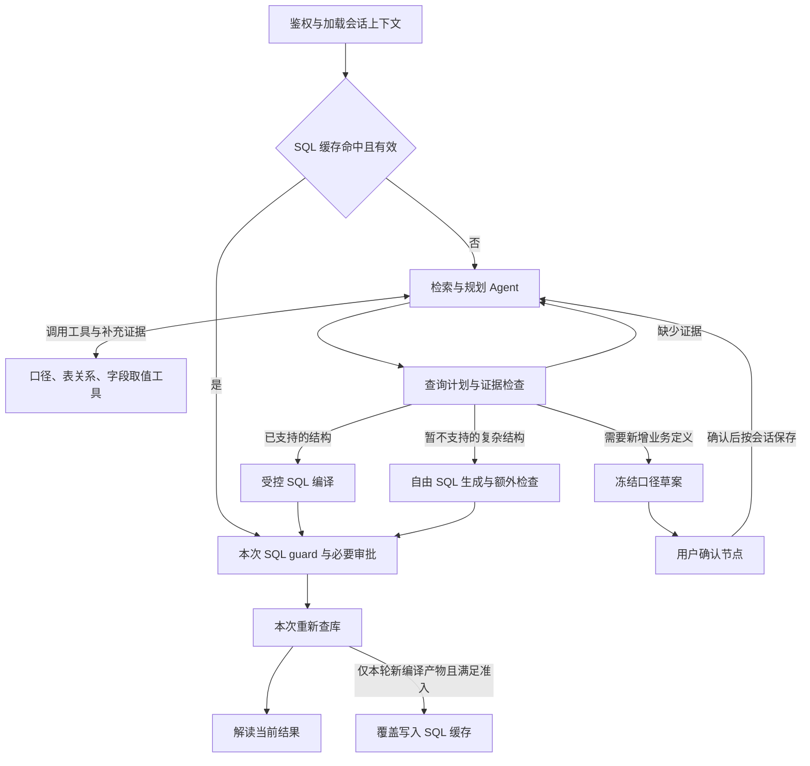

# SQL 准确性与复用架构设计

设计收敛日期：2026-11-25。本文描述后续实现目标，功能尚未实现。架构边界已在讨论中确认；标为“建议初值”的参数仍须通过本地负载验证。

## 已确认的决策

| 议题 | 决策 |
|---|---|
| 提高 SQL 正确率 | Agent 主动检索业务口径与数据库知识，生成带证据的查询计划 |
| 新增业务定义 | 提出计算定义并取得用户确认，再用于执行 |
| 新口径的作用域 | 仅当前会话复用，以 `session_id` 隔离不同会话 |
| 复杂查询 | 保留自由 SQL 分支，仍须接受计划与执行检查 |
| 复用内容 | 复用 SQL，每次重新查询数据库 |
| 自动缓存准入 | 仅受控编译路径；自由 SQL 不进入自动缓存 |
| 淘汰机制 | 单个进程级有界 LRU 容器，加固定 TTL 和字节预算 |

相关记录：[业务术语](../../CONTEXT.md)、[架构决策](../adr/0001-session-metrics-and-controlled-sql-reuse.md)。

## 当前代码与改造起点

- `app/agents/nodes.py` 固定调用 `search_schema()`，再通过 `_fmt_schema_context()` 提供表列名与指标文本。`matched_values` 尚未直接写入生成上下文，通用上下文也没有类型、主外键和关联基数。
- `app/agents/chat.py` 与 `app/infra/llm.py` 当前处理文本及 JSON，没有实现模型工具调用与工具返回消息的多轮循环。
- `app/tools/schema_registry.py`、维度值索引、SQL guard、只读执行器和 LangGraph 中断恢复机制可复用。
- `mem.preferences` 当前存储 `(session_id, term, choice)` 文本偏好，不具备结构化新口径、定义版本及确认草案的完整契约。
- `app/application/ask_service.py` 在新轮开始时重置本轮产物；新增查询计划、证据、草案和缓存来源也必须管理生命周期。

## 请求执行流程



真正的口径歧义也需用户澄清。用户拒绝草案时不保存定义，由用户修改需求或结束本轮。模型、工具、校验或执行失败应产生明确终态，不能无限循环。

## 检索 Agent 与证据

以下是拟新增的工具契约，不是现有 API：

| 工具 | 受控返回内容 |
|---|---|
| `search_metrics` | 指标候选、别名、说明、相关歧义组 |
| `get_metric_specs` | 完整公式、原生粒度、必要过滤、时间规则、单位及版本 |
| `describe_schema` | 允许使用的表列、类型、说明及经确认的关联边和基数 |
| `resolve_dimension_values` | 允许检索的业务取值及字段映射 |

Agent 根据工具结果继续补查；服务端限制工具、参数、返回规模和总调用预算。检索工具不提供任意业务 SQL 执行权，不读取 `eval` 金标，也不通过样例数据绕过现有敏感字段策略。

检索可组合别名、关键词及向量召回。得分用于排列候选，不代表消歧完成；同术语对应多个计算定义时，必须保留会改变结果的候选。字段关系来自元数据与业务关联定义，不能仅凭同名列推断正确 JOIN。

最终证据包引用真实的指标、字段、关联边和版本。模型不能自行创造一个 ID 作为“已注册口径”。

## 指标定义、查询计划与两条 SQL 路径

指标定义至少描述：身份和版本、计算表达式、原生粒度、时间规则、必要过滤、允许维度、单位与汇总规则。现有自由文本 `sql_hint` 不能直接拼接成可组合表达式，需要迁移为受控语义定义。

查询计划至少包含：

- 已选指标及定义版本，引用的证据。
- 输出维度、明确的过滤字段与值。
- 时间字段、绝对区间、时区与时间锚点。
- 目标粒度、允许的关联路径、排序与 TopN。
- 比率分子和分母各自的范围；去重与分阶段聚合要求。

受控编译器只承诺支持明确的表达式和查询结构。它从经过验证的计划与可信定义构建 SQL AST，显式处理 JOIN 放大、去重和分母范围，并绑定请求参数。

口径已经明确但结构尚不支持时，进入自由 SQL 分支。该分支仍须引用同一证据和查询计划，接受过滤、时间、粒度及输出约束检查，并独立记录来源。自由 SQL 通过检查和执行不等同于获得业务正确性的证明。

未知业务定义与未支持的查询结构分开处理：前者需要用户确认含义，后者可以走已同意保留的自由 SQL 分支。

## 新口径的确认与会话隔离

会话由 `session_id` 标识，并关联现有鉴权身份；不能把知道会话 ID 本身当作授权。口径状态按会话隔离，API、恢复执行、checkpoint 和新口径读取应使用一致的会话归属约定。

新口径的结构化记录至少保存：会话、局部指标 ID、确认的定义、定义内容摘要、修订号、所依赖的注册口径版本。相同定义的重复确认保持幂等；只有业务定义变化才增加修订号。

确认流程：

1. 规划节点生成候选定义，解释统计对象、公式、必要过滤、时间含义和单位。
2. 将草案 ID、内容摘要和版本冻结在服务端状态中。
3. 独立确认节点展示冻结草案并调用 `interrupt()`。
4. 恢复时核对会话归属、草案 ID 和版本，确认后保存本会话定义。
5. 当前问题明确指定的定义优先于历史选择；修改业务含义时再次确认。

LangGraph 恢复会重新进入节点，不能在确认节点恢复时生成另一份草案替换用户所见内容。

现有澄清事件与回答主要是文字，SQL 审批使用另一种对象格式。结构化口径确认需要扩展 SSE 类型、`/ask/resume` 校验及前端组件，绑定确认对象；不能把已有 SQL 审批直接当成口径确认。

已确认的会话口径独立持久化，不自动发布到共享口径注册表。SQL 缓存淘汰、进程重启或新轮临时状态清理不应删除该定义；“仅当前会话”表示相同 `session_id` 的作用域，不表示服务重启即失效。会话清除操作须同时清除对应定义与复用条目。

## SQL 缓存

### 容器与容量

所有会话共享一个进程级有界容器，key 中包含会话作用域；不为每个会话分配一份独立的无限增长缓存。单个容器内一个 key 只对应一个条目，重复写入执行覆盖更新。

建议初值：最多 1,000 条、单条序列化载荷最多 16 KiB、总序列化载荷最多 8 MiB、固定 TTL 30 分钟。载荷计入 key、SQL 和条目元数据；Python 对象与容器额外开销须通过实际内存观测验证。多进程部署时每个进程各有预算，不能把单进程上限当作全部 worker 的总上限。

命中更新 LRU 顺序，不延长固定 TTL。写入先清理过期项，覆盖时扣除旧值，再根据条数和字节预算淘汰最近最少使用项。定期清扫过期项，避免空闲时一直保留过期载荷；超大条目跳过缓存。

### key 与命中位置

首版覆盖相同完整问题及有效上下文的复用，不将相似措辞直接视作相同请求。

```text
key = hash(
    cache_namespace_version,
    api_scope_fingerprint,
    session_id,
    conservatively_normalized_question,
    effective_metric_choices_and_definition_hashes,
    effective_filters_and_resolved_references,
    time_context,
    schema_version, metric_version, compiler_version
)
```

key 在本轮模型调用前由问题、已确认口径、确定性规则和时间信息构造。第一版不跨会话共享缓存。若指代或口径尚不能确定，应继续正常检索和澄清，不能猜测后命中旧条目。

只纳入实际影响本题的上下文；无法精确筛选时可保守纳入稳定的会话口径定义快照。排除命中次数、更新时间、`turn_count`、摘要版本、随机结果 ID 和整份 checkpoint；这些变化不应使相同问题每轮失去复用机会。

本项目相对日期以 `data_as_of` 为锚点。key 必须覆盖时间锚点、时区和规则版本；能确定性解析时使用绝对区间。不同时间上下文不能仅凭相同文字“上个月”命中同一请求。

### 来源与准入

SQL 来源由后端分支设置，不能接受模型自报。建议显式区分 `controlled_compiler`、`controlled_cache` 和 `free_sql`，绑定编译器版本、定义摘要及 SQL 摘要。

仅当定义已确认、计划在编译器支持范围内、版本仍有效、检查通过且 SQL 执行成功时，本轮由 `controlled_compiler` 新生成的产物才能写入自动缓存。写入前再次核对版本，防止在途生成期间口径变更。`controlled_cache` 命中后执行成功只更新 LRU，不回填或重置到期时间；只有实际重新编译形成的新产物才开始新的固定 TTL。

自由 SQL 无论执行成功、获得用户审批或通过 SQL guard，都不进入首版自动缓存。若模型修改受控 SQL，修改后的产物应标记为 `free_sql` 并失去缓存资格；只有重新进入受控编译器并完成检查才能重新获得资格。

缓存不保存原始 rows、图表 URL、审批结果、SSE 流或会话执行状态。命中后重新鉴权、执行 guard、按本次需要审批、查库和生成解释。

命中条目执行失败时删除条目，清除旧缓存来源与编译证明，进入正常修复流程；若最终由自由 SQL 分支修复，仍然不得写回自动缓存。

### 失效与并发

口径发布、schema 迁移及编译规则变更须更新真实版本标识，不能把普通摘要轮次号当作版本。当前代码尚无完整版本发布机制，需要在实现中补充；TTL 不能替代版本失效。旧版本条目不再命中，同时清扫释放预算。

相同 key 的并发 SQL 生成可后续加入 singleflight。仅共享可复用的生成产物，各请求保留独立的审批、执行、取消和结果流；不合并整个 `ask()`。

## 状态、失败与可观测性

每轮临时状态包括证据、计划、工具消息、检索预算、未确认草案、SQL 来源与缓存证明，需在新一轮清理。已确认的会话口径独立保留并重新加载，`resume` 不执行新轮重置。

每轮缓存资格初始为不可缓存，不能沿用 checkpoint 中的历史资格。状态初始化失败时不得继续使用上一轮的确认、计划或编译证明。

失败按来源回退：缺少事实回检索、业务歧义回澄清、粒度冲突修正计划、构建错误修正 SQL、执行错误携带原问题和已确认定义修复。总模型轮次、工具调用数及请求时间必须有界，具体预算作为配置并通过真实模型验收确定。

观测至少区分受控编译、受控缓存、自由 SQL，记录请求关联、证据版本、失败阶段、模型及工具调用数、阶段耗时、缓存命中与失效原因。检索工具消息仅保留本轮所需内容；SQL 缓存的容量限制不能替代长期 trace/checkpoint 的体积治理。

## 实现顺序

1. 定义结构化指标、查询计划、会话口径和版本契约，统一现有时间口径规则。
2. 扩展模型适配与受控检索工具循环，补齐字段取值和关联证据。
3. 实现冻结草案、用户确认、按会话持久化及前后端恢复契约。
4. 实现受控编译、自由 SQL 分支和来源追踪，共用执行安全边界。
5. 加入有界 SQL 缓存、版本失效、命中失败回退与观测。
6. 完成真实服务集成和质量对照评测，再决定是否灰度启用。

可沿用现有 `app/domain/` 定义业务契约，`app/infra/` 承担会话口径存储及缓存，`app/agents/` 承担检索规划，`app/application/` 组织确认、编译与执行；具体文件拆分以实现时的依赖边界为准。

## 验收要求

| 场景 | 必须验证的行为 |
|---|---|
| 主动检索 | 证据不足能补查；必要候选没有被相似度排序静默丢弃 |
| 新定义 | 未确认不执行；确认对象与展示草案一致；拒绝不保存 |
| 同会话复用 | 新轮可使用确认定义；显式新定义优先；重启恢复不扩大作用域 |
| 会话隔离 | 不同 `session_id` 不继承定义或命中对方条目；会话归属检查一致 |
| 同 key | 重复写入仍为一个条目，覆盖后的容量账目正确 |
| 容量 | 条数、单条和总载荷限制有效；LRU 淘汰与过期回收均有覆盖 |
| TTL | 命中查库成功也不回写续期；SQL 到期不丢失会话定义 |
| 版本变化 | 旧条目不再命中；在途旧版本产物不能重新写回 |
| 缓存命中 | 规划/生成调用减少，但数据库本次仍被查询；审批不会继承 |
| 自由 SQL | 结构复杂时可走该分支，成功后也不写自动缓存 |
| 修复来源 | 受控 SQL 经模型修订后失去准入；下一轮不继承旧资格 |
| 业务语义 | 城市过滤、去重、JOIN 金额放大、时间字段和比率分母有对照用例 |
| 前端与中断 | 确认、修改、取消、过期草案和重复恢复能得到明确反馈 |

先用可控工具响应验证状态与路由，再使用可丢弃数据库和真实 Redis 验证集成；mock 测试不代表真实模型正确率。对相同数据快照及多组反例数据分别报告首轮/最终正确率、错误回答、误拒/澄清、两条 SQL 路径覆盖率，以及冷请求/缓存命中的耗时和成本。不能仅靠增加拒答提高“已回答问题正确率”，也不预先承诺准确率提升数值。
